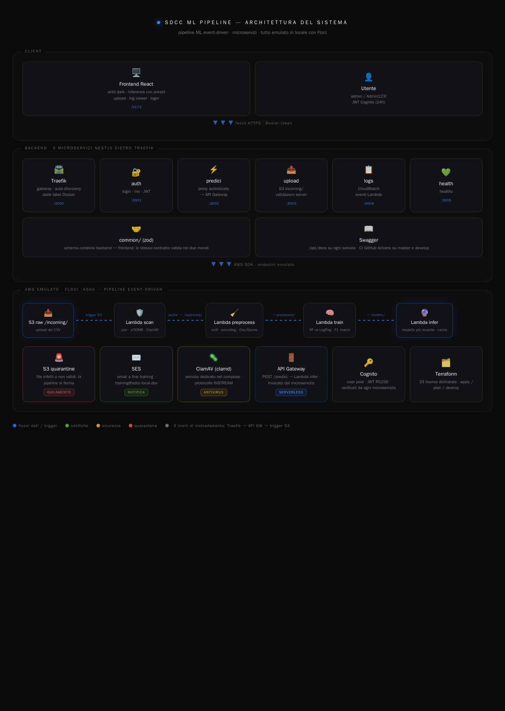

# SDCC ML Pipeline — Progetto di Sistemi Distribuiti e Cloud Computing

Una pipeline di machine learning interamente automatica su architettura serverless: il caricamento di un dataset innesta da solo pulizia dei dati, addestramento del modello ed endpoint di predizione in tempo reale. Tutto sviluppato e dimostrato in locale con **Floci**, l'emulatore AWS, e descritto come codice con **Terraform**.

- **Dataset**: [Room Occupancy Estimation (UCI)](https://archive.ics.uci.edu/dataset/864) — sensore ambientali di un'aula → numero di occupanti
- **Linguaggi**: Python (Lambda), TypeScript/NestJS (microservizi), React (frontend), HCL (infrastruttura)
- **Servizi AWS usati**: S3, Lambda, IAM, SES, API Gateway, Cognito, CloudWatch

## Come è fatto il sistema



Il sistema instrada il traffico in tre modi diversi, ognuno col suo scopo: **Traefik** porta le chiamate del browser ai microservizi (HTTP, autenticazione applicativa), l'**API Gateway AWS** dà accesso serverless alle funzioni Lambda, e i **trigger S3** governano la pipeline, dove nessuno chiama nessuno — sono i dati che, arrivando, fanno succedere le cose.

## Porte e servizi

| Servizio | Porta | Note |
|---|:---:|---|
| Floci (AWS emulato) | 4566 | endpoint API AWS |
| Floci UI | 4500 | console stile AWS (bucket, email SES, Lambda) |
| Traefik | 3000 | ingresso API del frontend |
| Traefik dashboard | 8080 | router e servizi auto-scoperti, live |
| auth / predici / upload / logs / health | 3001-3005 | i cinque microservizi NestJS |
| Frontend | 5173 | UI React |

Credenziali di accesso: **admin / Admin123!**

## Avviare tutto

> Prima volta? In [`ONBOARDING-KIT.md`](ONBOARDING-KIT.md) trovi i programmi da installare.

```bash
make up                                  # Floci, ClamAV, Traefik, microservizi, frontend
cd infra/terraform && terraform apply    # bucket, Lambda, ruoli, trigger, API GW, Cognito
```

Terraform genera gli identificatori Cognito che i microservizi aspettano: dopo l'apply esegui `terraform output -raw cognito_user_pool_id` e simili per il file `.env` (vedi `docker-compose.yml`). Per fermare o azzerare l'ambiente: `make down`, `make reset`.

I comandi principali sono anche target Nx: `./nx run-many --target=lint:python` (ruff), `lint:javascript` (Biome), `build:lambdas` o le singole `build:preprocess|train|infer|scan`, `scan:image` (Trivy).

## AWS CLI puntata su Floci

```bash
export AWS_ENDPOINT_URL=http://localhost:4566
export AWS_DEFAULT_REGION=eu-south-1
export AWS_ACCESS_KEY_ID=test
export AWS_SECRET_ACCESS_KEY=test

aws s3 ls
```

## L'infrastruttura come codice

Tutto ciò che esiste sul lato AWS è dichiarato in `infra/terraform/`, un file per area, e si ricrea da zero con `terraform apply` (o si smonta con `destroy`). Lo stato vive in `terraform.tfstate`: è la memoria di ciò che è stato creato, e permette ai `plan` successivi di mostrare solo le differenze.

| File | Contenuto |
|---|---|
| `main.tf` / `vars.tf` | provider AWS verso Floci, variabili (credenziali, region, mappa endpoint) |
| `s3.tf` | i bucket: `raw` (ingresso dati), `processed` (dati puliti), `models` (modelli), `quarantine` (file rifiutati), `artifacts` (pacchetti Lambda) |
| `ses.tf` | identità email per le notifiche di fine training |
| `iam.tf` | ruolo di esecuzione Lambda e policy a minimo privilegio |
| `lambda.tf` | le quattro funzioni: scan, preprocess, train, infer |
| `triggers.tf` | notifiche S3: `incoming/` → scan, `approved/` → preprocess, `_processed.csv` → train |
| `artifacts.tf` | caricamento degli zip Lambda su S3 (deploy indiretto, sopra i 50 MB) |
| `api.tf` | API Gateway `POST /predici` verso la Lambda infer, stage `dev` |
| `cognito.tf` | user pool, client e utente admin per l'autenticazione |

## Le funzioni Lambda

Quattro funzioni Python (runtime 3.12), ognuna col suo ruolo nella pipeline. Lo **scan** valida estensione, dimensione (via soli metadati) e antivirus; se il file è pulito lo promuove al prefisso `approved/`, altrimenti lo isola in quarantena. Il **preprocess** gestisce nulli (mediana sulle colonne numeriche), codifica le eventuali colonne categoriche, deriva da data e ora le feature `Ora` e `GiornoSettimana` — l'occupazione di un'aula segue l'orario delle lezioni — e standardizza le feature salvando lo scaler. Il **train** addestra random forest e regressione logistica, le confronta sull'F1 macro e serializza la migliore con `joblib`, accanto al proprio scaler e a un report in JSON; a fine lavoro invia l'email di notifica via SES. L'**infer** serve le predizioni: sceglie il modello più recente, lo tiene in cache tra le invocazioni e risponde con la classe predetta e le probabilità per classe.

Il packaging di ogni funzione è uno zip con codice e dipendenze, costruito dallo script `scripts/build_lambdas.py` con wheel Linux per Python 3.12 (vedi `docs/DOCUMENTAZIONE.md` per il perché). Lo zip della scan pesa pochi kilobyte: usa solo la standard library e boto3, già nel runtime.

## L'endpoint di inferenza

L'API Gateway espone `POST /predici`. L'URL in stile AWS viene dagli output Terraform; su Floci l'endpoint locale è `http://localhost:4566/restapis/<api-id>/dev/_user_request_/predici`, e il microservizio `predici` lo invoca per conto del frontend.

Richiesta: le 18 feature dei sensori in JSON. Risposta:

```json
{
  "persone_predette": 1,
  "modello_usato": "ultimo_modello.joblib",
  "probabilita_per_classe": { "0": 0.02, "1": 0.79, "2": 0.12, "3": 0.07 }
}
```

Input incompleto o non numerico → 400 con l'elenco dei campi in errore.

## La sicurezza

Gli upload vengono controllati tre volte, tutte lato server: estensione, dimensione massima e scansione ClamAV (servizio dedicato nel compose, protocollo INSTREAM). I file sospetti finiscono in quarantena e la pipeline si ferma. L'autenticazione è di Cognito: JWT firmati RS256, validati da ogni microservizio con la chiave pubblica del pool. Le richieste e le risposte del BFF sono validate con schema **zod condivisi** tra backend e frontend — lo stesso contratto, eseguito nei due posti. Le password di default e i segreti nei file di compose sono intenzionali per l'ambiente locale di sviluppo e vanno sostituiti in qualunque deploy reale.

## Scelte di progetto, e perché

**Floci invece di AWS reale o LocalStack.** Sul cloud vero ci sarebbero costi, un account e un ambiente non riproducibile per chi valuta. Tra gli emulatori, Floci porta una console web inclusa e tutti i servizi che servivano. Il codice resta identico al deploy reale: cambia l'endpoint.

**Python per le Lambda, non Java.** Tutto l'ecosistema ML citato dalla traccia vive in Python; i runtime Lambda Python sono leggeri; e le funzioni sono script brevi. Il frontend resta nel mondo React, dove le competenze erano già consolidate.

**Classificazione multi-classe, non regressione.** Il numero di occupanti ha quattro valori possibili: predire numeri continui non avrebbe senso, e da qui la scelta degli estimator `Classifier` e delle probabilità per classe nella risposta.

**Random forest, con la regressione logistica come termine di paragone.** Su sedici feature numeriche di sensori la random forest è tra le più accurate senza richiedere riscalatura, e resiste all'overfitting; il confronto con un modello lineare dà una motivazione basata sui dati (F1 macro 0.992 contro 0.982) invece che sul gusto.

**Notifiche email a fine training.** Un training può durare minuti: la Lambda invia un'email via SES, intercettata dall'emulatore e visibile nella console — zero email reali, flusso identico alla produzione.

**Terraform invece di script o SAM.** Dichiarare lo stato desiderato con `plan` e `destroy` a disposizione rende l'ambiente riproducibile con due comandi: chiunque clona il repository ricostruisce tutto.

**Microservizi e Traefik invece del BFF monolitico.** Un solo servizio avrebbe raccontato poco in un corso di sistemi distribuiti. Cinque microservizi, un'immagine Docker parametrizzata, e un ingresso che si configura da solo leggendo le label dei container: aggiungere un servizio è aggiungere due righe al compose.

**Nx e Makefile.** I task di build, lint e verifica girano sotto Nx (cache e un punto d'ingresso unico); Make resta la scorciatoia per i comandi dell'infrastruttura.

## Struttura del repository

```
docker-compose.yml     Floci, ClamAV, Traefik, i 5 microservizi, il frontend
infra/terraform/       l'infrastruttura AWS come codice
lambdas/               scan, preprocess, train, infer (Python)
backend/               i microservizi NestJS e il codice condiviso (common)
frontend/              l'app React (basic-ui, sections)
scripts/               build delle Lambda, test end-to-end
data/raw/              il dataset originale
playground/            gli esperimenti ML svolti in locale
docs/DOCUMENTAZIONE.md la storia del progetto, con gli errori e le lezioni
RELAZIONE.md           la relazione per l'esame
REQUISITI.md           requisiti funzionali e non, con tracciamento
ONBOARDING-KIT.md      i programmi da installare per partire
```

## Verificare che tutto funzioni

```bash
bash scripts/e2e_test.sh
```

Dodici controlli che coprono l'intero flusso: autenticazione, upload di un file pulito con attesa della pipeline completa, upload di un file infetto con verifica della quarantena, inferenza valida e invalida, lettura dei log. È lo stesso copione della demo.
